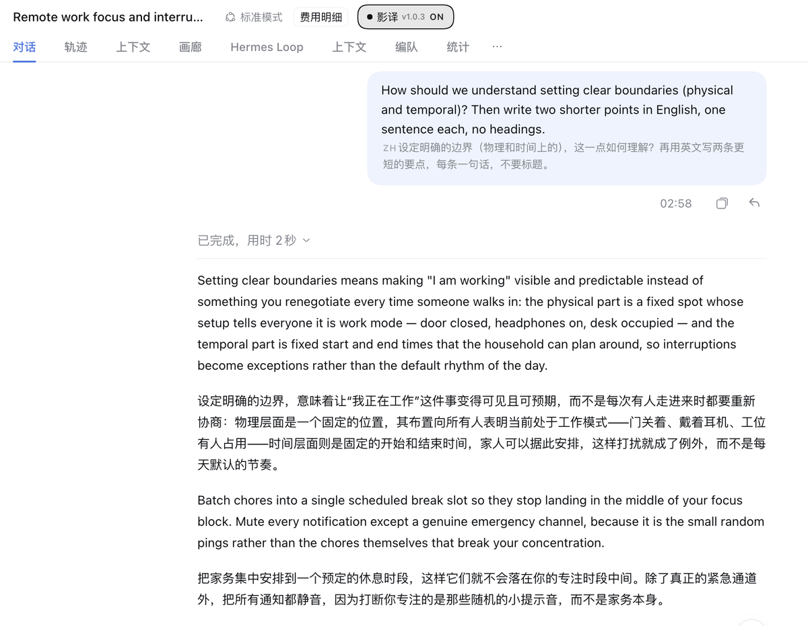

# Shadow Bilingual · 影译


[中文](#中文) · English

A DSH plugin: **English-only conversation with the model, bilingual display for you.**
Chinese name: **影译**. Version [`1.0.3`](CHANGELOG.md).



Forked from [Hemuchuan/dsh-bilingual](https://github.com/Hemuchuan/dsh-bilingual) and reworked around
the *send* path: upstream keeps the assistant-side bilingual rendering, and this fork adds English
shadow input, English-only sending across the composer / steering box / message queue, and a
selectable display language.

---

## What it does

| Capability | Where | Origin |
| --- | --- | --- |
| Assistant replies: English body + local-language line underneath | `conversation.chat.node` (key `assistant-step`) | upstream |
| User messages: English is what gets sent; local-language original shown under the bubble | `conversation.user.text.node` (key `text`) | this fork |
| "Send translation" checkbox, checked by default | `conversation.composer.dock` | this fork |
| Steering box (`dsh-steer-note`) text is translated before sending | `textarea.dsh-steer-note-input` | this fork |
| Queued messages (sent while the agent is busy) are translated in place | `conversation.input.dock` id `shadow-bilingual-queue` | this fork |
| Model always answers in English | system prompt section `bilingual:response-language` (order 9500) | this fork |
| **Selectable local display language** (18 languages) | Settings → Shadow Bilingual | this fork |

### Language model

Two independent languages, deliberately:

- **AI side is always English.** The model only ever reads English, which is the cheapest and most
  reliable input for it. Anything you type in another language is rewritten into English *before*
  it is sent — in the composer, in the steering box, and in the message queue.
- **Display side is whatever you pick.** The assistant's English reply gets a translation in your
  local language underneath. Pick it under **Settings → Shadow Bilingual → 本地显示语言**.

Supported display languages: `zh` (Simplified Chinese), `zh-TW` (Traditional), `ja`, `ko`, `es`, `fr`,
`de`, `pt`, `ru`, `it`, `nl`, `pl`, `tr`, `ar`, `hi`, `th`, `vi`, `id`.

Translations are cached **per target language**. Switching the display language never reuses the
previous language's wording; it re-translates new paragraphs as needed.

## Install

From the DSH plugin market, or from a terminal:

```bash
# desktop app (profile "desktop")
dsh plugin --profile desktop add github:Naskita/shadow-bilingual

# hosted web build (profile "web")
dsh plugin --profile web add github:Naskita/shadow-bilingual
```

The install writes the package and its bundle patch row; it does **not** start the plugin. Quit the
app normally (`⌘Q`) and reopen — the host half is imported at process start, and the client half
loads with the window.

Then open **Settings → Shadow Bilingual** and paste a DeepSeek API key, or export `DEEPSEEK_API_KEY`
(the plugin also reuses a key DSH already stores). Without a key the plugin stays installed but every
translation fails, and text is sent as-is.

There is no npm package and no dependency to install: the host half talks to the app over
`/api/shadow-bilingual/*`, and the client half gets React from the DSH client runtime.

## How it works (read this before changing anything)

- **Where the user's local-language original comes from.** On send, the interceptor records an
  `English → original` pair into localStorage (`shadow-bilingual.sent.v1`, capped at 200 entries,
  keyed by whitespace-normalized English). The bubble looks the message body up in that map, and
  falls back to entries in the translation cache that really are in the local script. If neither
  matches, no second line is shown — it never invents one.
- **Why not `conversation.chat.user.before`.** Measured: this chain slot only receives
  `source = {kind, rpcId, clientTimeZone}`. There is no message text in it (see `docs/PLAN.md`).
- **Why not `conversation.chat.user.content`.** It is a singleton Factory; registering it again from
  outside neither errors nor takes effect (measured), and replacing it would drop attachments.
  Only **keyed** slots can be taken over reliably.
- **Send interception.** A capture-phase listener on `document` watches `keydown Enter` and clicks on
  the send button. On a hit it calls `preventDefault` → translates → `inputActions.setDraft(english)`
  → `inputActions.submit()`. Shift/Alt, IME composition (`isComposing` / `keyCode 229`) and
  auto-repeat are skipped.
- **The steering box is a second input.** It belongs to the `dsh-steer-note` plugin
  (`textarea.dsh-steer-note-input`) and has nothing to do with the main composer; it sends through
  `sessionRemote.prompt({mode:'steer'})`. It is a **controlled React component** whose `send()`
  reads `latestTextRef` (state), not the DOM — so you must use the native value setter plus an
  `input` event, wait a frame, then click its own button. Writing to the DOM alone does nothing.

- **All three send paths must be covered** — miss one and non-English text leaks through:

  | Path | Entry point | Delivered | How it is handled |
  | --- | --- | --- | --- |
  | Main composer | composer | immediately, when idle | shadow translation preview → submit the translation on send |
  | Steering box | `dsh-steer-note` textarea | end of the current step | set value + input event → click its own button |
  | Message queue | DSH inbox `next-turn` | as the next turn, after the whole turn ends | `useProjection('inbox')` + `updateQueue({kind:'edit'})` |

  The queue path **does not go through any text box**: messages you send while the agent is working
  land in the official inbox, invisible to the composer interceptor. That is where non-English text
  used to leak out.

- **The shadow translation lives inside the input box.** 900 ms after you stop typing, a grey English
  continuation appears directly under your draft. It diffs per paragraph against the cache and only
  requests paragraphs it has not seen — it is not a full re-translation on every keystroke. During a
  re-translation the previous version stays visible, dimmed and labelled "updating…", so nothing
  flickers.
- **You cannot send before the translation is ready.** Clicking send while it is still translating
  shows "translating… (will send when done)" and the event is swallowed — nothing is submitted.
  As soon as the translation lands it **sends automatically**; you do not press send again. This is
  what prevents the "original goes out, then the English version goes out" double send.
- **Failure, stalls and unusable translations do not block you.** A failed translation falls back to
  the original text immediately; a stalled one falls back after 15 seconds. A translation is only
  accepted when it is non-empty, starts with a Latin letter and **differs from your draft** — a reply
  that merely echoes your Chinese counts as a failure, not as a translation. The panel then says
  `翻译失败，将发送原文` and the next send goes out as the original. Sending the original is always
  better than trapping you in the composer.
- **The host decides "already English" by function words, not by counting letters.** `looksEnglish()`
  in `lib/index.js` requires `latin >= 2`; text without any CJK passes straight through; text that
  contains CJK must additionally hit **at least two English function words** (the same
  `ENGLISH_HINTS` list the client uses). Counting Latin letters alone is wrong: in
  `帮我装插件hermes-loop` the identifier supplies 10 letters against 5 Han characters, which used to
  be misread as English and skipped translation.
- **Queued messages are only rewritten when the row is pure text.** Rows carrying images or files are
  skipped, because rewriting `content` would drop the attachments. Those arrive in the original
  language — a deliberate trade-off.

## Known boundaries (design trade-offs, not bugs)

- Only text a human sends **through those three paths** is intercepted. Messages generated by the UI
  or the host itself (continuations such as "继续", retries) never pass through them and are sent
  verbatim.
- Drafts that are already English are neither translated nor replaced.
- A single paragraph longer than 5000 characters is skipped (keeps one request from growing unbounded).
- On translation failure the text is sent **as-is**; the steering box behaves the same way.
- The assistant-side "English body + local line" layout comes from upstream and is kept.

## Configuration

- Host config: `~/.dsh/shadow-bilingual.json` (API Key / model / Base URL / `forceEnglish` / `localLanguage`)
- Key precedence: plugin config → `DEEPSEEK_API_KEY` → DSH credentials service
- Routes: `/api/shadow-bilingual/{config,translate,test,health}`
- Settings page: Settings → Shadow Bilingual

## Build and install

```bash
cd /Users/naskita/Documents/deepseek-harness/default-workspace/shadow-bilingual
node build.mjs     # lib/markdown.cjs + lib/client.template.js → lib/client.js
```

First-time install (links this checkout into the profile):

```
plugin_manager install_bundle target=/Users/naskita/Documents/deepseek-harness/default-workspace/shadow-bilingual
```

Applying a change after that — whether you edited a file yourself or pulled a new commit:

```bash
./scripts/apply-changes.sh          # rebuild lib/client.js, then report whether the host half is stale
./scripts/apply-changes.sh --test   # same, plus the full self-check
```

The script only reads; it never signals the app. What it tells you:

- **Client half** (`lib/client.js`) hot-loads into the open window. Press `⌘R` if it does not.
- **Host half** (`lib/index.js`) is imported once, when the app process starts. `plugin_manager
  set_bundle`, and even remove + reinstall, do **not** re-import a symlinked host module (measured —
  see `docs/PLAN.md` D10). The script recognises that state (the host compiles a `logic` marker into
  `/health`), exits `2`, and prints the only safe remedy: **quit normally (`⌘Q`), then reopen**.

**Never kill the host to force a reload.** SIGTERM makes Electron report "app stopped unexpectedly"
and show its crash dialog — that is exactly what produced the 2026-11-17 restart loop. This repo
deliberately ships no script that does it.

## Self-check

Everything below runs without touching the real UI — far faster than poking the interface:

```bash
./tests/run-all.sh        # build + unit tests + send-path assertions + slot listing
```

Individually:

```bash
node build.mjs                                        # template → lib/client.js
node --test tests/*.test.mjs                          # 25 unit tests (client + host + markdown)
node tests/send-path.cjs lib/client.js                # 24 send-path assertions
node tests/list-slots.cjs lib/client.js               # which slots got registered
node scripts/check-languages.mjs                      # live host: probe all 18 display languages
```

`check-languages.mjs` talks to the running host (it finds the port itself) and fails loudly when a
display language comes back untranslated — the failure mode that unit tests cannot see. It needs the
app running and a Key configured; run it after any change to the host half.

`send-path.cjs` covers: one Enter submits once, repeated Enter while a translation is in flight
does not duplicate, failure sends the original, a stalled translation times out and sends the
original, a translation that comes back identical to the draft (the "host says it is already
English" case) releases the gate instead of swallowing every keypress, a Chinese queue row is
rewritten to English, rows with attachments are left alone, a failed queue translation keeps the
original, the same row is not translated twice, and exactly one `document` listener set exists.

There is no devtools on the desktop app; verification uses the accessibility tree:

```bash
agent-desktop snapshot --window-id <DSH window id> --timeout-ms 25000
```

## Changelog

See [CHANGELOG.md](CHANGELOG.md). Recent releases:

- **1.0.3** (2026-11-18) — Chinese name **影译**, an icon and a real screenshot; ten
  Latin-script display languages and Simplified↔Traditional Chinese now actually translate (they
  used to be skipped as "already translated"); the header toggle now shows 影译 with this package's
  version.
- **1.0.2** (2026-11-18) — packaging only: `repository`/`bugs`/`homepage` in the manifest, the
  bogus `react` peer dependency removed (React comes from the DSH client runtime), an accurate
  preview image, and an **Install** section for `dsh plugin --profile desktop add github:...`.
- **1.0.1** (2026-11-18) — assistant subtitles render again (decorate key mismatch), mixed-language
  paragraphs are translated instead of skipped, host "already English" detection uses English
  function words, and the send gate no longer swallows a draft when a translation comes back
  unusable.
- **1.0.0** (2026-11-17) — first tagged local build: three send paths, 18 display languages,
  per-target cache, selectable display language.

---

<a id="中文"></a>

# 中文说明

DSH 插件：**跟模型对话全英文，界面显示双语**。
中文名：**影译**。版本 [`1.0.3`](CHANGELOG.md)。

从 [Hemuchuan/dsh-bilingual](https://github.com/Hemuchuan/dsh-bilingual) fork 后围绕**发送链路**改造：
助手侧的双语渲染沿用上游，本 fork 增加了英文影子输入、输入框/插话框/消息队列三条路径的全英文发送，
以及可选的本地显示语言。

## 它做什么

| 能力 | 位置 | 来源 |
| --- | --- | --- |
| 助手回复：英文正文 + 下方本地语言对照 | `conversation.chat.node` (key `assistant-step`) | 沿用上游 |
| 用户消息：发送的是英文，气泡内下方显示本地语言原文 | `conversation.user.text.node` (key `text`) | 本定制新增 |
| 「发送译文」勾选框，默认勾选 | `conversation.composer.dock` | 本定制新增 |
| 插话框（dsh-steer-note）里打本地语言也译成英文再发 | `textarea.dsh-steer-note-input` | 本定制新增 |
| 排队中的消息（我干活时你发的）就地译成英文 | `conversation.input.dock` id `shadow-bilingual-queue` | 本定制新增 |
| 模型始终用英文回复 | 系统提示词 section `bilingual:response-language` (order 9500) | 本定制新增 |
| **本地显示语言可选**（18 种） | 设置 → 双语 | 本定制新增 |

### 语言模型

刻意分成两种语言：

- **AI 侧永远是英文。** 模型只读英文——这是最省 token、也最可靠的输入。你打的任何非英文内容，
  都会在**发送之前**改写成英文：主输入框、插话框、消息队列，三条路径都管。
- **显示侧跟随你的选择。** 助手的英文回复下方，会补一份你选的本地语言对照。
  在 **设置 → 双语 → 本地显示语言** 里选。

支持：`zh` 简体中文、`zh-TW` 繁體中文、`ja` 日本語、`ko` 한국어、`es` Español、`fr` Français、
`de` Deutsch、`pt` Português、`ru` Русский、`it` Italiano、`nl` Nederlands、`pl` Polski、
`tr` Türkçe、`ar` العربية、`hi` हिन्दी、`th` ไทย、`vi` Tiếng Việt、`id` Bahasa Indonesia。

译文**按目标语言分别缓存**。换语种不会读到上一种语言的措辞，新段落按新语言重译。

## 安装

从 DSH 插件市场安装，或在终端里：

```bash
# 桌面版（profile 名 desktop）
dsh plugin --profile desktop add github:Naskita/shadow-bilingual

# 网页版 dsh web（profile 名 web）
dsh plugin --profile web add github:Naskita/shadow-bilingual
```

安装只写入包与 bundle 补丁行，**不会启动插件**。正常退出（`⌘Q`）再重开：宿主那一半在进程启动时
被 import，客户端那一半随后随窗口加载。

然后打开 **设置 → 双语**，粘贴 DeepSeek API Key；也可以 export `DEEPSEEK_API_KEY`
（插件也会复用 DSH 已保存的 Key）。没有 Key 时插件仍在，但每次翻译都会失败，文本按原文发送。

本插件不发 npm 包，也不需要安装任何依赖：宿主侧走 `/api/shadow-bilingual/*`，客户端侧从 DSH
运行时拿 React。

## 关键实现（改之前先读这段）

- **用户消息的本地语言原文怎么来的**：发出前拦截器把 `英文 → 原文` 记进 localStorage
  (`shadow-bilingual.sent.v1`，上限 200 条，键是空白归一化后的英文全文)。
  渲染时用消息正文去查这张表；查不到就退回译文缓存里**确实是本地文字**的条目。
  都查不到就不显示第二行——不会编造。
- **为什么不用 `conversation.chat.user.before`**：实测该 chain 槽位拿到的 `source`
  只有 `{kind, rpcId, clientTimeZone}`，没有正文（见 `docs/PLAN.md` 记录）。
- **为什么不用 `conversation.chat.user.content`**：它是单例 Factory，外部重复注册
  不报错但也不会被选中（实测），且替换它还会丢附件。只有 **keyed** 槽位能稳定接管。
- **发送拦截**：`document` 捕获阶段监听 `keydown Enter` 与 `click` 发送按钮，
  命中后 `preventDefault` → 翻译 → `inputActions.setDraft(english)` → `inputActions.submit()`。
  跳过 Shift/Alt、IME 组合态 (`isComposing` / `keyCode 229`) 与长按自动重复。
- **插话框是第二套输入**（`dsh-steer-note` 插件的 `textarea.dsh-steer-note-input`），
  和主输入框完全无关，走的是 `sessionRemote.prompt({mode:'steer'})`。
  它是**受控 React 组件**，`send()` 读的是 `latestTextRef`（state），不是 DOM——
  所以必须用原生 setter + `input` 事件让 React 更新，等一帧再点它的按钮。
  只改 DOM 文本是没用的。

- **三条发送路径都要管**（缺一条就会漏）：

  | 路径 | 入口 | 送达时机 | 怎么拦 |
  | --- | --- | --- | --- |
  | 主输入框 | composer | 我空闲时立刻 | 影子译文预览 → 点发送时提交译文 |
  | 插话框 | `dsh-steer-note` 的 textarea | 当前 step 结束 | 改 value + input 事件 → 点它自己的按钮 |
  | 消息队列 | DSH 官方 inbox `next-turn` | 整轮结束后作为下一轮 | `useProjection('inbox')` + `updateQueue({kind:'edit'})` |

  队列这条**不经过任何输入框**：我在干活时你发的消息进的是官方 inbox，
  主拦截器根本看不到它。之前队列里的中文就是这样漏出去的。

- **影子译文在输入框里**：你打字停下 900ms 后，草稿正文下面会直接出现灰色的英文续写。
  它按段落做 diff，已经翻过的段直接命中缓存，只把新出现的段落发出去——不是每次整段重译。
  重译时上一版译文不会消失，只是淡化并标注「更新中…」，所以看不到闪烁。
- **译文没出来之前发不出去**。这时点发送，面板会显示「正在翻译…（翻译完成后发送）」，
  事件被吞掉、不会提交；译文一就绪就**自动替你发出去**，不需要再点一次。
  这是为了避免「原文先发、英文再发」的双发。
- **翻译失败、卡住、或译文不可用都不挡你**：失败立刻退回、原文照发；卡住 15 秒后同样退回。
  译文**只有**非空、以拉丁字母开头、且与你草稿不同才算数——模型把中文原样退回来算「失败」，
  不算「译文」。这时面板会显示 `翻译失败，将发送原文`，再按一次发送就发原文。
  宁可发原文，也不把你锁死在输入框前。
- **宿主判「已经是英文」靠英语虚词，不靠数拉丁字母。** `lib/index.js` 的 `looksEnglish()`
  要求 `latin >= 2`；不含中日韩文字的文本直接放过；含中日韩文字的必须再命中
  **至少两个英语虚词**（与客户端同一份 `ENGLISH_HINTS`）。只数拉丁字母会误判：
  `帮我装插件hermes-loop` 里标识符贡献 10 个字母、汉字只有 5 个，旧逻辑把它当英文跳过了翻译。
- **排队消息只处理纯文本行**：带图片/文件的行跳过（改 content 会丢附件）。
  这类消息会以原文送达，是有意的取舍。

## 已知边界（不是 bug，是设计取舍）

- **只拦截「人经这三条路径发出的字」**。
  由界面或宿主自己产生的消息（"继续"这类续跑、重试）不经过以上任何路径，仍会以原文发出。
- 纯英文草稿不翻译、不替换。
- 单段超过 5000 字符的草稿跳过翻译（避免一次请求过大）。
- 翻译失败时**原样发送**，不会卡住发送（插话框同样：翻译失败就点它自己的按钮原样发）。
- 助手侧英文正文 + 本地语言对照是上游行为，已按需求保留。

## 配置

- 宿主配置：`~/.dsh/shadow-bilingual.json`（API Key / 模型 / Base URL / `forceEnglish` / `localLanguage`）
- Key 优先级：插件配置 > `DEEPSEEK_API_KEY` 环境变量 > DSH 凭据服务
- 路由：`/api/shadow-bilingual/{config,translate,test,health}`
- 设置页：设置 → 双语

## 构建与安装

```bash
cd /Users/naskita/Documents/deepseek-harness/default-workspace/shadow-bilingual
node build.mjs     # lib/markdown.cjs + lib/client.template.js → lib/client.js
```

首次安装（把本目录 link 进 profile）：

```
plugin_manager install_bundle target=/Users/naskita/Documents/deepseek-harness/default-workspace/shadow-bilingual
```

之后的每次生效——无论是自己改了文件，还是 `git pull` 拿到新提交：

```bash
./scripts/apply-changes.sh          # 重建 lib/client.js，再报告宿主半是否过期
./scripts/apply-changes.sh --test   # 同上，并跑完整自检
```

脚本只读，不会给应用发任何信号。它报告两件事：

- **客户端半**（`lib/client.js`）会热加载进已打开的窗口；没生效就按一次 `⌘R`。
- **宿主半**（`lib/index.js`）只在应用进程启动时 import 一次。`plugin_manager set_bundle`
  甚至 remove + 重装都**不会**重新 import 被 symlink 的宿主模块（实测，见 `docs/PLAN.md` D10）。
  脚本能认出这个状态（宿主把 `logic` 标记编译进 `/health`），退出码 `2`，
  并打印唯一安全做法：**正常退出（`⌘Q`）再重开**。

**不要用 kill 宿主的办法让插件生效。** SIGTERM 会让 Electron 报 "app stopped unexpectedly"
并弹崩溃窗——2026-11-17 的反复重启就是这么来的。本仓库刻意不再提供任何这样的脚本。

## 自检

下面这些都**不碰真实界面**，改完 bundle 跑一遍，比在界面上试错快得多：

```bash
./tests/run-all.sh        # 构建 + 单测 + 发送链路断言 + 槽位清单，一次跑完
```

分开跑：

```bash
node build.mjs                                        # 模板 → lib/client.js
node --test tests/*.test.mjs                          # 25 项单测（client + host + markdown）
node tests/send-path.cjs lib/client.js                # 24 项发送链路断言
node tests/list-slots.cjs lib/client.js               # 打印注册了哪些槽位
node scripts/check-languages.mjs                      # 对运行中的宿主逐个显示语言探一次
```

`check-languages.mjs` 直接问正在运行的宿主（端口自己找），某种显示语言拿回来的还是原文就直接
报错——这是单测看不见的失败模式。需要应用开着、Key 已填；改完宿主侧代码跑一次。

`send-path.cjs` 覆盖：单次 Enter 只提交一次、翻译在飞时连按不重复、翻译失败发原文、
翻译挂起超时发原文、超时后锁已释放、译文与草稿完全相同（宿主误判「已是英文」）时闸门放行
而不是每次都吞键、队列中文行被译成英文、带附件行不动、队列翻译失败保留原文、
同一行不重复翻译、document 监听器唯一。

界面上没有 devtools，验证靠无障碍树：

```bash
agent-desktop snapshot --window-id <DSH 窗口 id> --timeout-ms 25000
```

## 更新日志

见 [CHANGELOG.md](CHANGELOG.md)。最近三个版本：

- **1.0.3**（2026-11-18）——中文名定为「影译」，补上图标与真实截图；十种拉丁字母显示语言
  与简繁中文真正开始翻译（此前被当成「已翻译」跳过）；会话头开关显示「影译」与本包版本号。
- **1.0.2**（2026-11-18）——只改打包：清单补上 `repository`/`bugs`/`homepage`，删掉多余的
  `react` peer（React 由 DSH 客户端运行时提供），换成与当前界面一致的示意图，README 增加
  面向使用者的「安装」小节（`dsh plugin --profile desktop add github:...`）。
- **1.0.1**（2026-11-18）——助手侧中文对照恢复渲染（decorate 的键没带目标语言）；
  混排段落不再因为出现一个汉字就被整段跳过；宿主判「已经是英文」改用英语虚词；
  译文不可用时发送闸门不再永久吞掉草稿。
- **1.0.0**（2026-11-17）——首个本地发布版：三条发送路径、18 种显示语言、
  按目标语言分别缓存、显示语言可选。

## License

MIT. Assistant-side bilingual rendering derives from
[Hemuchuan/dsh-bilingual](https://github.com/Hemuchuan/dsh-bilingual) (MIT).
